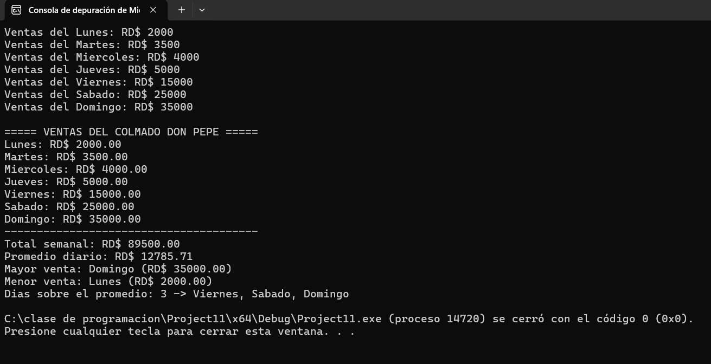

# Ventas del Colmado Don Pepe

Programa en C++ que registra las ventas diarias de un colmado (de lunes a domingo), las guarda en un arreglo unidimensional y muestra un resumen semanal: total vendido, promedio diario, día de mayor y menor venta, y los días que superaron el promedio.

**Estudiante:** Samuel Junior Montero Zapata
**Asignatura:** Lógica de Programación
**Docente:** Gamalier Reyes del Carmen

## Compilar y ejecutar

Requiere un compilador de C++ (por ejemplo, g++).

```bash
g++ -o ventas main.cpp
./ventas
```

En Windows (PowerShell o CMD) se ejecuta con `ventas.exe`.

## Captura de pantalla de la ejecución



## Características

- Arreglo `double` para las ventas y arreglo `string` para los nombres de los días.
- Tamaño definido con la constante `const int DIAS = 7;`.
- Ciclos `for` para llenar y recorrer los arreglos.
- Validación: no acepta ventas negativas ni texto; vuelve a pedir el dato.
- Sin variables globales (excepto `DIAS`), sin `vector`, sin matrices y sin datos fijos.
